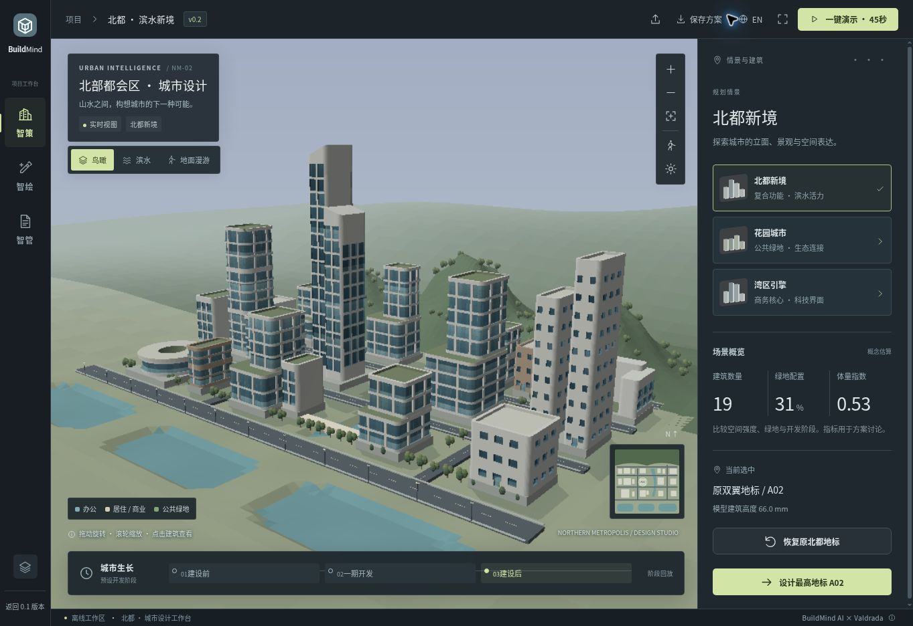

  

  <strong>面向建筑全生命周期的多智能体 AI 决策引擎</strong> 
  Connecting urban planning, architectural design and construction intelligence.

  <a href="docs/PROJECT_CARD.md">项目愿景</a> ·
  <a href="#one-project-three-perspectives">三大模块</a> ·
  <a href="#see-it-take-shape">产品预览</a> ·
  <a href="demo-v0.2/README.md">体验演示</a> ·
  <a href="Retrieval/README.md">研究代码</a>

## Great places begin with better decisions.

一座城市的未来，始于无数彼此关联的决定：土地如何开发，空间如何生长，建筑如何成形，工程如何落地。

**BuildMind AI 希望把这些决定连接起来。** 我们正在构建面向城市开发与工程建设的 AI 决策与协同平台，让规划者、建筑师和工程团队在同一个项目里理解问题、比较方案、调整设计、追溯依据。

从城市尺度的情景推演，到一栋建筑的反复打磨，再到一份施工文件的审查——让空间、知识与行动形成持续反馈，让人的专业判断拥有更好的工具。

## One project. Three perspectives.

<table>
  <tr>
    <td width="33%" valign="top">
      <h3>01 / 智策</h3>
      <strong>让规划看得见未来。</strong>
      
以城市情景推演连接土地、建筑、产业与人的活动，让不同开发路径可以被看见、比较与讨论。

      城市理解 · 多智能体仿真 · 规划反馈
    </td>
    <td width="33%" valign="top">
      <h3>02 / 智绘</h3>
      <strong>让想象更快成为空间。</strong>
      
围绕参考建筑与设计意图，编排多模态工具，形成从候选方案到三维表达、交互修改和成果交付的创作流程。

      参考理解 · 方案生成 · 三维共创
    </td>
    <td width="33%" valign="top">
      <h3>03 / 智管</h3>
      <strong>让工程决策有据可依。</strong>
      
从施工文档切入，连接问题、原文、规范依据与修改记录，让审查结果进入可追溯的项目协同过程。

      文档理解 · 知识检索 · 审查协同
    </td>
  </tr>
</table>

三个模块共享项目语境：规划给出方向，设计回应空间，工程反馈约束。我们希望每一次修改，都能成为下一次决策的起点。

## See it take shape.

**北都 · 滨水新境** 是这条产品路径的第一个可交互窗口。

从实体打印模型走进三维街区：观察城市生长，选中最高的 A02 地标，比较三种建筑表达，再进入施工文件的证据链。一次 **45 秒**的演示，把三个模块串成一个项目故事。

  

流线曲面 / 玻璃双塔 / 层叠花园 — 同一块地，三种空间表达。0.2 延续北都原有建筑与山水格局。

  <a href="demo-v0.2/README.md"><strong>进入演示 →</strong></a> &nbsp; · &nbsp;
  <a href="demo/docs/review-preview.jpg">查看智管界面</a> &nbsp; · &nbsp;
  <a href="demo/docs/PRINT_MODEL.md">从打印模型到数字街区</a>

## Built to connect ideas with evidence.

我们的研发方向，是把**多智能体协同、多模态工具编排与工程知识检索**接入同一条项目工作流。AI 负责组织信息、探索方案与调用工具，专业团队负责选择、判断与确认。

| 演进方向 | 正在走向的能力 |
| :--- | :--- |
| **城市 → 情景** | 从街区可视化走向城市规划、多智能体推演与政策反馈 |
| **参考 → 设计** | 从候选方案交互走向参考条件驱动的生成、评估与迭代 |
| **文件 → 决策** | 从问题定位走向规范检索、版本关联与工程协同闭环 |

当前仓库开放三模块交互原型与检索研究代码。0.2 接入参数化地标生成与交互编辑，文档审查仍使用示例；参考图驱动生成、城市仿真及自动审查服务将逐步接入；运行与实现说明统一放在 [`demo-v0.2/`](demo-v0.2/README.md)。

## Contributors · 一起把想法变成作品

BuildMind AI 由团队与 AI 开发协作者共同打磨，让产品想法、专业判断与工程实现不断靠近。

| 共创者 | 贡献 |
| :--- | :--- |
| **BuildMind AI 团队 · [@ShuKK777](https://github.com/ShuKK777)** | 产品愿景、研究与工程资产、场景定义及项目决策 |
| **Codex / ChatGPT（OpenAI）** · AI 开发协作者 | 三模块演示开发、界面与视觉设计、三维交互与动效优化、项目文档及 45 秒演示视频制作 |

---

  <strong>BuildMind AI · 智筑未来</strong> 
  从一座建筑，到一座城市。从一个想法，到更好的现实。

