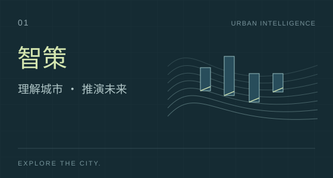
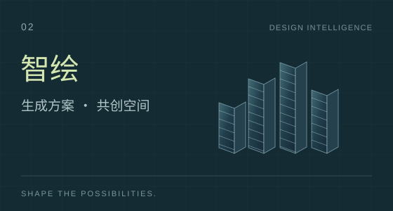
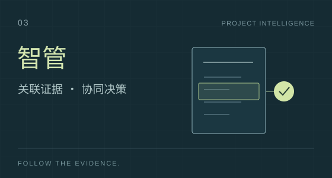
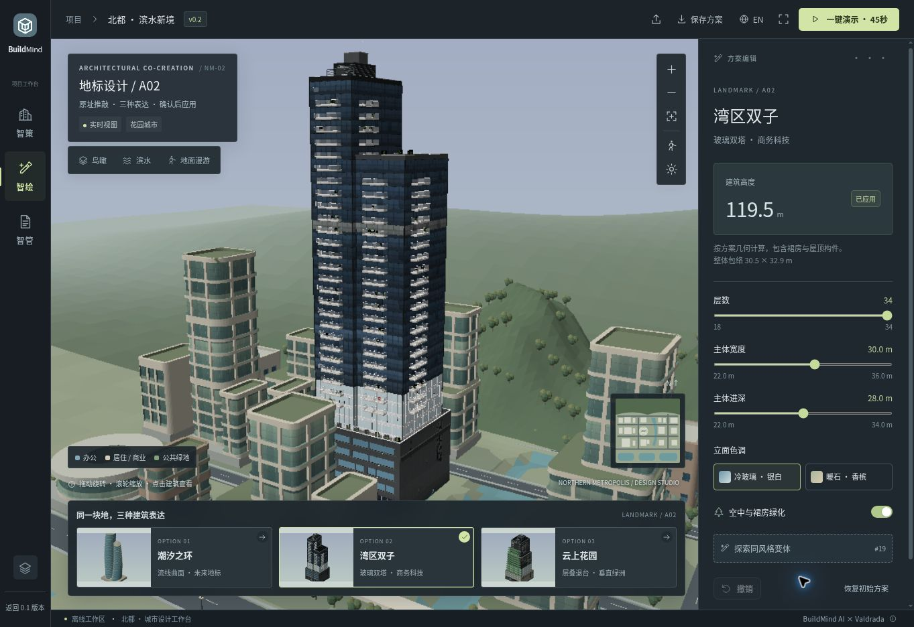
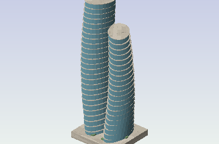
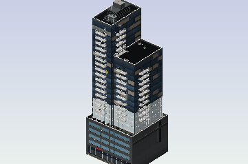
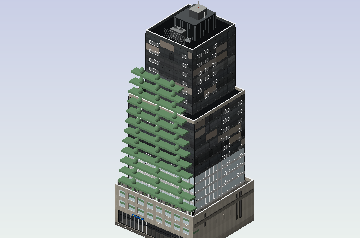

  

  <strong>面向建筑全生命周期的多智能体 AI 决策引擎</strong> 
  Planning, architecture and construction. One connected project.

  <a href="docs/PROJECT_CARD.md">项目愿景</a> &nbsp; / &nbsp;
  <a href="#experience">产品预览</a> &nbsp; / &nbsp;
  <a href="CHANGELOG.md">0.2 更新</a> &nbsp; / &nbsp;
  <a href="demo-v0.2/README.md">体验演示</a> &nbsp; / &nbsp;
  <a href="#code-map">代码地图</a>

## 把城市、建筑与工程，放进同一个项目。

一片土地如何生长，一栋建筑如何成形，一份方案如何落地——这些决定本来就彼此相连。

**BuildMind AI 希望让这种联系，在工具里真正发生。** 让规划者看见不同的发展路径，让建筑师更快比较空间的可能，让工程团队把问题带回原文、依据与修改过程。AI 组织信息、调用工具与探索方案，专业团队选择方向、作出判断。

我们想连接的，是从城市想象到工程现实的整个过程。

## One project. Three perspectives.

<table>
  <tr>
    <td width="33%" valign="top">
      
      
<strong>这片土地，可以如何发展？</strong>

      
从城市状态与规划意图出发，走向可比较的开发情景与多智能体推演。

      
当前窗口：北都三维街区、开发阶段与景观表达。

    </td>
    <td width="33%" valign="top">
      
      
<strong>这个想法，可以成为怎样的建筑？</strong>

      
围绕参考建筑与设计意图编排多模态工具，让候选方案在比较、选择与修改中收敛。

      
当前窗口：三套程序化地标、米制参数与共享街区编辑。

    </td>
    <td width="33%" valign="top">
      
      
<strong>这份方案的依据在哪里？</strong>

      
把施工文档中的问题、规范知识与修改记录连接起来，让审查进入项目协同。

      
当前窗口：Word / PDF 预览、示例问题与原文定位。

    </td>
  </tr>
</table>

规划给出方向，设计回应空间，工程带回约束。每一次修改，都能成为下一次决策的起点。

## 把想法，放进城市里。

**北都 · 滨水新境 / Demo 0.2** 是这条产品路径的第一个可交互窗口。

保留北都原有的建筑轮廓与山水格局，在同一个设计工作台里观察开发阶段，选中 A02 地标，比较三种建筑语言，再进入施工文件的原文与依据。可以一键播放 **45 秒**，也可以随时停下来，继续推敲自己的方案。

  

实际工作台画面 · 米制建筑参数 · 智策与智绘共享方案

<table>
  <tr>
    <td width="33%" align="center"> <strong>潮汐之环</strong> 流线曲面 / Future landmark</td>
    <td width="33%" align="center"> <strong>湾区双子</strong> 玻璃双塔 / Connected skyline</td>
    <td width="33%" align="center"> <strong>云上花园</strong> 层叠花园 / Vertical landscape</td>
  </tr>
</table>

  <a href="demo-v0.2/README.md"><strong>打开 0.2 演示说明 →</strong></a> &nbsp; · &nbsp;
  <a href="demo/docs/review-preview.jpg">查看智管示例</a> &nbsp; · &nbsp;
  <a href="demo/README.md">回到 0.1</a>

## 0.2，让共创更连贯。

- **建筑回到设计尺度。** 层数、宽深与高度使用米制几何；修改参数后，将方案应用到同一片街区。
- **演示成为连续叙事。** 45 秒连续运镜、候选提前准备与画面平滑过渡，支持暂停、继续和恢复原方案。
- **选择可以被保留。** 草稿、撤销、原楼恢复与项目 JSON 导入导出，让探索有来有回。
- **原有资产继续生长。** 0.1 完整保留，Valdrada 建筑生成与构件代码进入独立模块，为智策和智绘后续复用打底。

[完整更新记录](CHANGELOG.md) · [实现与验证记录](docs/v0.2/IMPLEMENTATION.md) · [代码来源与授权](third_party/valdrada/NOTICE.md)

## 从交互窗口，走向持续反馈。

| 从哪里出发 | 希望走向哪里 |
| :--- | :--- |
| **一片街区** | 连接城市数据与多主体行为，让开发路径能够比较、推演与反馈。 |
| **一栋建筑** | 连接参考理解、任务分解与多模态工具，让生成、修改与评估进入同一条工作流。 |
| **一份文件** | 连接工程知识检索、原文定位与版本记录，让审查形成可追溯的协同过程。 |

当前公开版本提供交互原型、程序化地标生成与检索研究代码。参考图驱动生成、真实城市预测与自动文档审查，是后续持续接入的能力。

## 找到你想继续构建的那一层。

| 入口 | 内容 |
| :--- | :--- |
| [`demo-v0.2/`](demo-v0.2/README.md) | 当前工作台、离线运行、体验流程与开发验证 |
| [`packages/scene-core/`](packages/scene-core/) | 共享场景、项目状态、渲染与后台绘制 |
| [`packages/building-kit/`](packages/building-kit/) | 建筑生成适配、米制几何与设计包络 |
| [`packages/scenario/`](packages/scenario/) · [`packages/showcase/`](packages/showcase/) | 情景数据、城市活动、相机与演示时间线 |
| [`Retrieval/`](Retrieval/README.md) | 工程知识检索研究代码 |
| [`third_party/valdrada/`](third_party/valdrada/NOTICE.md) | 固定版本的上游代码、MIT 许可证与来源校验 |
| [`demo/`](demo/README.md) | 完整保留的 0.1 演示 |

## 一起把想法，变成作品。

| 共创者 | 贡献 |
| :--- | :--- |
| **BuildMind AI 团队 · [@ShuKK777](https://github.com/ShuKK777)** | 产品愿景、研究与工程资产、场景定义及项目决策 |
| **Codex / ChatGPT（OpenAI）** · AI 开发协作者 | 演示开发、视觉与交互设计、三维动效、项目文档与演示素材共创 |

感谢 [Valdrada](https://github.com/mkturkcan/valdrada) 的建筑生成与构件工作。复用部分的作者、版本及授权保存在[来源说明](third_party/valdrada/NOTICE.md)中。

[项目愿景与项目卡](docs/PROJECT_CARD.md) · [共创指南](CONTRIBUTING.md) · [版本记录](CHANGELOG.md)

---

  <strong>BuildMind AI · 智筑未来</strong> 
  从一座建筑，到一座城市。从一个想法，到更好的现实。

