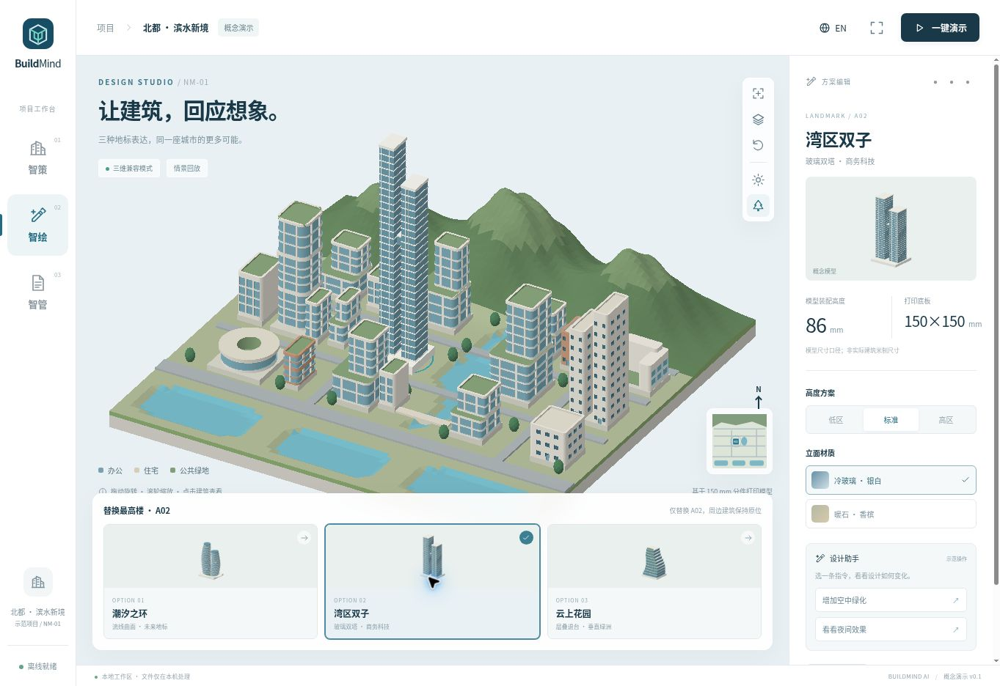
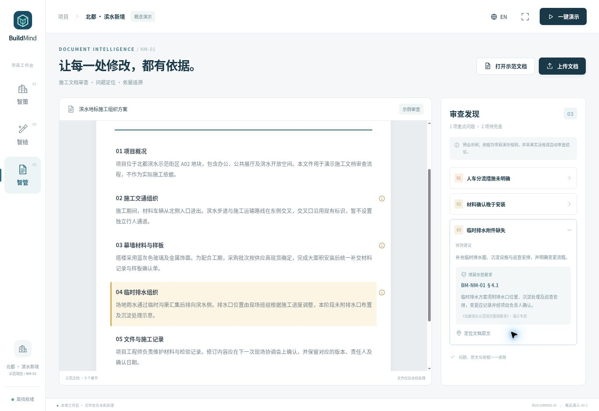

# Validation record — 2026-10-25

## Automated

`node --test demo/tests/*.test.mjs`: **10 tests passed**.

Covers persisted-state validation; height changes; 90-second script ordering and module coverage; sample finding/source/evidence mapping; file type/size boundaries; local asset presence; 27-part source identity/coordinates/top-height; A02 being the tallest source tower; immutable original height; SHA-256 checks for 205 bundled dependency files; loopback HTTP GET/HEAD, MIME, write rejection and traversal rejection.

## Browser interaction

Verified in the managed Chromium preview at 1363×936:

- Before stage displays eight village houses and farmland; after stage displays original 19-building assembly.
- Original A02 height 72 mm; all three replacement cards update the scene and details; restore returns the original tower and 72 mm.
- Glass twins standard 86 mm, sky gardens standard 66 mm; height controls update geometry and label.
- Pointer drag rotates the real scene. Clicking a residential building selects A04 and shows its 49.3 mm assembled height.
- Applying a chosen variant returns it to the district; surrounding source meshes remain in place.
- Chinese/English navigation and document sample text switch.
- Showcase paused/resumed, then ran to completion and returned to Plan with Sky Gardens/night state preserved.
- Sample finding 03 expands its evidence and highlights/scrolls to drainage source text.
- DOCX fixture renders text paragraphs, including literal `<script>` text without executing it, with no assigned findings.
- Local PDF fixture renders; Next displays actual second-page content and `2 / 2`, with Next disabled.
- Own-source syntax checks and `git diff --check` passed.

## Limits / target-device check

The managed browser disables WebGL. Browser observations above use the explicit CPU 3D compatibility mode, with shared mesh geometry, camera and ray picking. Accelerated WebGL lighting/shadows have **not** been visually tested here. Windows/macOS launcher execution, very large or encrypted PDFs, and mobile screen sizes have not been exercised on physical target devices.

Offline readiness is established by shipped local dependencies and source/asset checks. No network-toggle test was available in the managed browser. Before a competition, launch the included server on the actual presentation machine, disconnect its external network, then try the three modules and 90-second playback once.

## Screenshots

