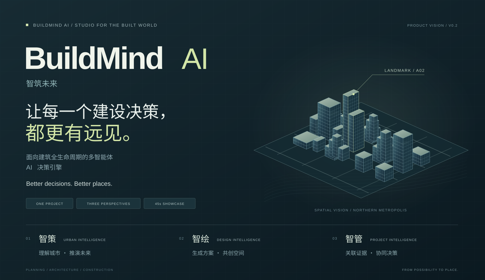

# 智筑未来 · BuildMind AI

**面向建筑全生命周期的多智能体 AI 决策引擎**  
面向城市开发与工程建设的 AI 决策与协同平台。

[下载 PNG 项目卡](assets/project-card.png) · [查看矢量项目卡](assets/project-card.svg)

## 我们想创造什么

我们希望建设项目的每个参与者，都能在同一个项目语境下工作：规划者看见不同发展路径，建筑师把设计意图变成可比较的空间，工程团队把文件与现场问题转化为有依据的行动。

让 AI 走进规划、设计和建设之间的协作过程，帮助团队更早看见影响、更快探索可能、更清楚地做出决定。

## 三个入口，一条完整的项目路径

| 模块 | 面向的问题 | 产品愿景 |
| :--- | :--- | :--- |
| **智策 / Urban Intelligence** | 这片土地可以如何发展？ | 连接城市数据、空间表达与多智能体推演，比较开发情景并获得规划反馈。 |
| **智绘 / Design Intelligence** | 这个想法可以成为怎样的建筑？ | 以参考建筑和设计意图为条件，编排理解、生成、建模、渲染与评估工具，支持候选比较和逐步修改。 |
| **智管 / Project Intelligence** | 这份方案的依据在哪里，问题如何闭环？ | 将施工文档中的问题连接到原文、规范知识和修改记录，形成可追溯的审查与协同过程。 |

## 产品的共同语言

**一个项目上下文。** 城市、地块、建筑与文档相互关联，让信息在不同角色之间延续。

**一组可以比较的选择。** 先展开可能性，再由专业团队选定方向、逐步收敛。

**一条看得见的证据链。** 让建议能够回到输入、依据、工具过程和人工确认，而不是停留在孤立的答案。

**一次持续的反馈。** 设计回应规划，工程反馈约束，新的判断继续进入下一轮探索。

## 第一个窗口：北都 · 滨水新境

项目已有一套可交互的演示工作台：把 150 mm 实体打印街区带入网页，回放建设前后情景，在 A02 最高地标处比较三套建筑方案，并演示施工文档的问题定位与依据追溯。45 秒自动播放串联完整体验，也可以随时停下来自由探索。

这是产品愿景的可交互原型。当前方案与示例审查为预制内容；后续重点是接入真实城市仿真、参考驱动生成、工程知识检索与审查服务。

## 一起把想法变成作品

**BuildMind AI 团队 × Codex / ChatGPT（OpenAI）**。团队负责产品愿景、研究与工程资产及项目决策；Codex / ChatGPT 作为 AI 开发协作者，参与演示开发、视觉与交互设计、动效优化、项目文档和演示视频制作。

[查看产品演示与运行说明](../demo/README.md) · [查看研究代码](../Retrieval/README.md) · [返回仓库首页](../README.md)

> 从一座建筑，到一座城市。从一个想法，到更好的现实。
